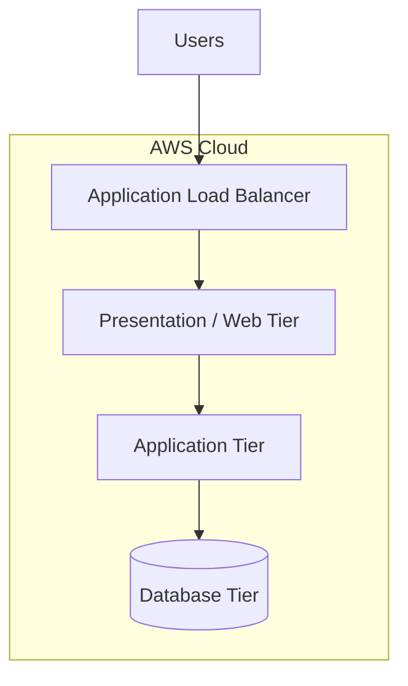

# HA 3-Tier AWS Platform

A Terraform-based project for designing and deploying a highly available, secure, and scalable three-tier application infrastructure on Amazon Web Services (AWS).

The project focuses on Infrastructure as Code (IaC), network segmentation, infrastructure reliability, and repeatable cloud deployments.

## Architecture

The platform follows a three-tier architecture pattern:



The exact components, subnet placement, and traffic flow depend on the Terraform configuration implemented in this repository.

## Objectives

- Provision AWS infrastructure using Terraform.
- Separate application layers for better organization and security.
- Design for availability and scalability.
- Manage infrastructure changes through version control.
- Validate Terraform configurations before deployment.
- Document deployment, verification, and cleanup procedures.

## Technology Stack

| Technology | Purpose |
|---|---|
| Amazon Web Services (AWS) | Cloud infrastructure |
| Terraform | Infrastructure as Code |
| Git and GitHub | Version control and collaboration |
| GitHub Actions | Infrastructure validation automation, when configured |
| Application code | Application-layer implementation |

## Repository Structure

```text
HA-3-Tier-AWS-Platform/
├── app/          # Application source code
├── terraform/    # Infrastructure as Code
└── README.md     # Project documentation
```

Additional directories and automation workflows may be added as the project evolves.

## Prerequisites

Install the following tools before deploying:

- An AWS account with appropriate permissions
- AWS CLI
- Terraform
- Git
- An AWS credentials profile configured locally

Verify your installation:

```bash
aws --version
terraform version
git --version
aws sts get-caller-identity
```

## Getting Started

### 1. Clone the repository

```bash
git clone https://github.com/KaleeswarG25/HA-3-Tier-AWS-Platform.git
cd HA-3-Tier-AWS-Platform
```

### 2. Configure AWS credentials

Configure a named AWS CLI profile or use an existing credentials mechanism.

```bash
aws configure --profile dev
aws sts get-caller-identity --profile dev
```

Use an IAM identity with only the permissions required for deployment. Never commit AWS access keys or secret credentials.

### 3. Inspect the Terraform configuration

```bash
cd terraform
terraform fmt -check -recursive
terraform init
terraform validate
```

Review the existing variables, provider configuration, modules, and outputs before proceeding.

### 4. Review the deployment plan

```bash
terraform plan
```

Review the planned resource creation, modifications, and deletions before applying changes.

### 5. Deploy the infrastructure

```bash
terraform apply
```

Run this command only after reviewing the plan, confirming the configuration, and understanding the expected AWS charges.

### 6. Verify the deployment

```bash
terraform output
```

Use the outputs defined by the project to identify available endpoints and resource information. Verify application health using the actual endpoint and health-check configuration.

## Infrastructure Validation

Before committing Terraform changes, run:

```bash
terraform fmt -check -recursive
terraform validate
terraform plan
```

These checks help detect formatting problems, configuration errors, and unexpected infrastructure changes. A successful validation does not guarantee that deployment will succeed.

## Security Considerations

- Keep application and database resources private wherever appropriate.
- Restrict inbound security-group rules to required sources and ports.
- Follow least-privilege IAM practices.
- Avoid hardcoding passwords, tokens, and access keys.
- Use encryption for supported data stores and network traffic.
- Review Terraform plans before applying changes.
- Keep Terraform state files and sensitive variable files out of Git.
- Prefer managed access mechanisms over exposing SSH publicly.

Security controls should be verified against the actual deployed configuration.

## Cost Management

AWS resources may incur charges even when an application receives no traffic.

- Review estimated costs before deployment.
- Check NAT Gateway, load balancer, database, and compute costs.
- Avoid leaving test environments running unnecessarily.
- Inspect existing resources before destroying infrastructure.
- Use AWS billing tools to monitor spending.

## Cleanup

When the environment is no longer required, inspect the Terraform plan and destroy only the resources managed by the intended Terraform state.

```bash
terraform plan -destroy
terraform destroy
```

**Warning:** Destruction can permanently remove resources and data. Back up any required data and confirm the target AWS account and Terraform workspace before proceeding.

## Improvement Roadmap

Potential improvements will be added after implementation and testing.

- **Infrastructure validation:** run Terraform formatting and validation automatically.
- **Network security:** verify subnet routing and restrict unnecessary inbound access.
- **Reliability:** verify health checks, redundancy, and database recovery procedures.
- **Observability:** introduce suitable metrics, logs, and alerts.
- **Cost control:** document resource costs and environment cleanup.

This roadmap describes possible future work, not features guaranteed to be deployed.

## Skills Demonstrated

This project provides practical experience with:

- AWS infrastructure design
- Terraform and Infrastructure as Code
- Cloud networking and security
- Version control and change management
- Infrastructure validation and troubleshooting
- Deployment documentation and cost awareness

## Author

**Kaleeswar G**

GitHub: [@KaleeswarG25](https://github.com/KaleeswarG25)

## License

Add a `LICENSE` file if you intend to publish this project under an open-source license.

## Development Workflow

Use a review-first workflow for infrastructure changes.

1. Create a branch for the proposed change.
2. Review the Terraform configuration and variables.
3. Run formatting and validation checks.
4. Inspect the Terraform execution plan.
5. Apply only approved changes.
6. Verify the resulting resources and application behavior.

```bash
terraform fmt -check -recursive
terraform init
terraform validate
terraform plan
```

Run these commands from the Terraform root module. Review the backend and provider configuration before initialization.

