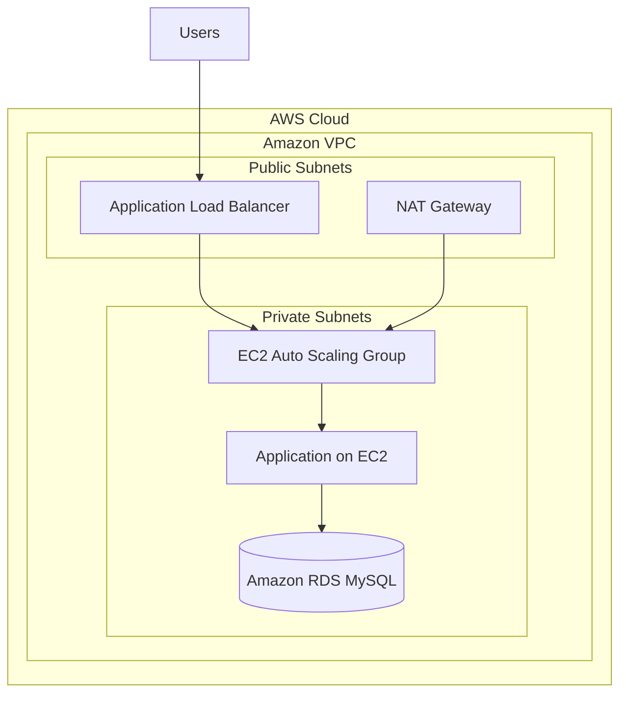

# HA 3-Tier AWS Platform

A Terraform-based AWS infrastructure project that demonstrates how to design, provision, and manage a highly available, scalable, and secure three-tier application platform using Infrastructure as Code (IaC).

The project brings together AWS networking, load balancing, Auto Scaling, a managed relational database, infrastructure validation, and deployment documentation in a version-controlled repository.

## Architecture

The platform follows a three-tier architecture with network segmentation and managed AWS services.



For a detailed explanation of the architecture, network design, traffic flow, and reliability considerations, see [Architecture Documentation](docs/architecture.md).

### Architecture components

| Component | Purpose |
|---|---|
| Amazon VPC | Provides an isolated network environment |
| Public and private subnets | Separate internet-facing and internal resources |
| Internet Gateway | Enables internet connectivity for public resources |
| NAT Gateway | Supports outbound internet access from private subnets |
| Application Load Balancer | Distributes incoming HTTP traffic |
| EC2 Auto Scaling Group | Manages application instances and scaling |
| Launch Template | Defines EC2 instance configuration |
| Amazon RDS for MySQL | Provides a managed relational database |
| Multi-AZ database deployment | Improves database availability |
| IAM instance profile | Grants AWS permissions to EC2 instances |
| CloudWatch alarms and scaling policies | Support monitoring and Auto Scaling |
| GitHub Actions | Automates Terraform configuration checks |

The exact implementation and resource settings are defined in the Terraform configuration. Consult the code before assuming a particular security or availability control is enabled.

## Project Objectives

- Provision AWS infrastructure using reusable Terraform modules.
- Implement network segmentation between public and private resources.
- Distribute application traffic through an Application Load Balancer.
- Configure EC2 Auto Scaling for application capacity management.
- Deploy a managed MySQL database with Multi-AZ support.
- Apply security-group rules based on required traffic flows.
- Validate infrastructure configuration before deployment.
- Manage infrastructure changes through Git and GitHub.
- Document architecture, troubleshooting, verification, and cleanup procedures.
- Understand AWS availability, reliability, security, and cost trade-offs.

## Technology Stack

| Technology | Purpose |
|---|---|
| Amazon Web Services | Cloud infrastructure |
| Terraform | Infrastructure as Code |
| Amazon VPC | Network isolation and routing |
| EC2 and Auto Scaling | Application compute and scaling |
| Application Load Balancer | Application traffic distribution |
| Amazon RDS for MySQL | Managed relational database |
| AWS IAM | Identity and access management |
| Amazon CloudWatch | Monitoring and scaling alarms |
| Git and GitHub | Version control and collaboration |
| GitHub Actions | Terraform validation automation |
| Bash | Application bootstrap and user-data scripting |

## Repository Structure

```text
HA-3-Tier-AWS-Platform/
├── .github/
│   └── workflows/
│       └── terraform-validation.yml
├── app/
│   └── userdata.sh
├── docs/
│   └── architecture.md
├── terraform/
│   ├── .gitignore
│   ├── .terraform.lock.hcl
│   ├── main.tf
│   ├── output.tf
│   ├── variables.tf
│   └── modules/
│       ├── alb/
│       │   └── main.tf
│       ├── asg/
│       │   └── main.tf
│       ├── rds/
│       │   └── main.tf
│       ├── security-groups/
│       │   └── main.tf
│       └── vpc/
│           └── main.tf
└── README.md
```

### Terraform module responsibilities

- `modules/vpc/` — VPC, subnet, gateway, and routing configuration.
- `modules/security-groups/` — Network access rules for the application infrastructure.
- `modules/alb/` — Load balancer, target group, and listener configuration.
- `modules/asg/` — EC2 launch template, Auto Scaling Group, IAM configuration, and scaling resources.
- `modules/rds/` — RDS MySQL instance, subnet group, and database-related configuration.
- `main.tf` — Root module that connects the infrastructure modules.
- `variables.tf` — Configurable infrastructure inputs.
- `output.tf` — Exposes selected deployment outputs.
- `app/userdata.sh` — Bootstraps the application environment on EC2 instances.
- `.github/workflows/terraform-validation.yml` — Automates configured Terraform checks.
- `docs/architecture.md` — Detailed architecture and infrastructure documentation.

## Prerequisites

Install the following tools:

- An AWS account with the required permissions.
- AWS CLI.
- Terraform.
- Git.
- A terminal such as PowerShell, Bash, or a Linux shell.

Verify your installations:

```bash
aws --version
terraform version
git --version
aws sts get-caller-identity
```

Review the configured AWS account and region before creating resources.

## Getting Started

### 1. Clone the repository

```bash
git clone https://github.com/KaleeswarG25/HA-3-Tier-AWS-Platform.git

cd HA-3-Tier-AWS-Platform
```

### 2. Configure AWS credentials

Configure a named AWS CLI profile or use an existing supported credentials mechanism.

```bash
aws configure --profile dev

aws sts get-caller-identity --profile dev
```

Set the profile for the current shell session if needed.

Linux or macOS:

```bash
export AWS_PROFILE=dev
```

PowerShell:

```powershell
$env:AWS_PROFILE = "dev"
```

Use an IAM identity with only the permissions required for the deployment. Never commit access keys, secret credentials, or sensitive configuration files.

### 3. Initialize Terraform

Navigate to the Terraform root module:

```bash
cd terraform
```

Format and initialize the configuration:

```bash
terraform fmt -recursive
terraform init
```

Validate the configuration:

```bash
terraform validate
```

Review the provider configuration, variables, modules, outputs, and state configuration before continuing.

### 4. Review the deployment plan

```bash
terraform plan
```

Inspect the proposed resources and identify any unexpected replacements, deletions, or changes.

Confirm the target AWS account, region, variables, and expected charges before proceeding.

### 5. Deploy the infrastructure

```bash
terraform apply
```

Run this command only after reviewing the plan and accepting the potential AWS costs.

Terraform will ask for confirmation before applying the planned changes unless approval is handled through another configured mechanism.

### 6. Verify the deployment

Inspect the available Terraform outputs:

```bash
terraform output
```

Check the Application Load Balancer endpoint and test the application using the actual endpoint and health-check path configured in the project.

Verify the infrastructure through the AWS Console or AWS CLI, including:

- VPCs, subnets, route tables, and gateways.
- Load balancer listeners and target health.
- EC2 instance status and Auto Scaling Group capacity.
- RDS availability and connectivity.
- Security-group rules.
- CloudWatch alarms and scaling activities.

A successful Terraform apply does not by itself prove that the application is functioning correctly.

## Infrastructure Validation

Run the following commands before committing Terraform changes:

```bash
terraform fmt -check -recursive
terraform validate
terraform plan
```

These checks serve different purposes:

- **Formatting:** Identifies files that do not follow Terraform formatting conventions.
- **Validation:** Checks Terraform configuration syntax and internal consistency.
- **Planning:** Shows the infrastructure changes Terraform intends to make.

The repository also includes a GitHub Actions workflow for automated Terraform validation.

Workflow configuration: [Terraform Validation Workflow](.github/workflows/terraform-validation.yml).

Validation and planning do not guarantee that AWS deployment will succeed. AWS permissions, service quotas, regional availability, and runtime configuration can still cause failures.

## Security Considerations

Security is an important part of infrastructure design and should be verified against the actual implementation.

- **Network segmentation:** Keep application and database resources in appropriate private subnets.
- **Security groups:** Restrict inbound traffic to required ports and trusted security-group sources.
- **IAM:** Apply least-privilege permissions to users, roles, and EC2 instances.
- **Database access:** Avoid public database exposure and allow only required application traffic.
- **Secrets management:** Avoid hardcoding database passwords, API keys, and tokens.
- **Encryption:** Enable encryption for supported storage and protect network traffic with appropriate TLS configuration.
- **Instance metadata:** Prefer IMDSv2 for EC2 instance metadata access.
- **State protection:** Treat Terraform state as potentially sensitive and keep local state files out of Git.
- **Change review:** Inspect Terraform plans before applying infrastructure changes.
- **Access management:** Prefer managed access mechanisms over exposing SSH publicly.

The current load balancer configuration should be checked before production use. If the application is exposed over HTTP, configure HTTPS with an appropriate TLS certificate and listener before handling sensitive traffic.

Also verify that Terraform outputs do not unnecessarily expose credentials or other sensitive values.

## Reliability and Scalability

The project demonstrates several infrastructure patterns relevant to availability and scaling.

### Application availability

The Application Load Balancer and EC2 Auto Scaling Group provide a foundation for distributing traffic and maintaining application capacity.

Verify that:

- Targets are registered and passing health checks.
- Instances can be replaced when unhealthy.
- The Auto Scaling Group spans the intended Availability Zones.
- Scaling policies and CloudWatch alarms have appropriate thresholds.
- Instance bootstrap completes successfully.

### Database availability

The RDS configuration uses Multi-AZ deployment to improve availability.

Verify the backup retention period, maintenance settings, recovery process, encryption configuration, and database connectivity.

Multi-AZ improves availability, but it is not a substitute for a tested backup and recovery strategy.

### Network availability

Review the routing configuration and NAT Gateway placement. A single NAT Gateway may introduce a dependency on one Availability Zone and may result in cross-AZ traffic costs.

For production environments, evaluate the availability benefits and additional costs of deploying NAT Gateways across multiple Availability Zones.

## Cost Management

AWS infrastructure can incur charges even when the application receives little or no traffic.

Pay particular attention to:

- NAT Gateway hourly and data-processing charges.
- Application Load Balancer charges.
- EC2 instance runtime and attached storage.
- RDS instance runtime, storage, backups, and Multi-AZ deployment.
- CloudWatch metrics, alarms, and log ingestion.
- Data transfer between Availability Zones and to the internet.

Before deployment:

1. Review the Terraform plan.
2. Check the pricing of the selected AWS services in your target region.
3. Confirm the database and compute instance sizes.
4. Decide how long the test environment needs to remain active.
5. Inspect the AWS Billing and Cost Management dashboard.

Free Tier or promotional eligibility depends on the account, service, and usage conditions. Do not assume that all resources in this architecture are free.

## Troubleshooting

### Terraform initialization fails

- Verify internet connectivity and provider availability.
- Check the Terraform provider configuration.
- Review backend configuration if remote state is configured.
- Inspect the error message before modifying provider versions or lock files.

### AWS access is denied

```bash
aws sts get-caller-identity
```

Confirm the active identity, AWS profile, region, and required IAM permissions.

### The Terraform plan shows unexpected changes

- Check the active workspace and variable values.
- Inspect the current Terraform state.
- Review resource replacements and deletions.
- Investigate configuration drift before applying changes.

### Application Load Balancer targets are unhealthy

- Check the target group health-check path and port.
- Verify the EC2 instance security group permits traffic from the ALB security group.
- Inspect the application bootstrap script and service status.
- Review target health descriptions and application logs.

### The application cannot connect to RDS

- Confirm the RDS instance is available.
- Verify the database security group allows traffic from the application security group.
- Check the endpoint, database name, credentials, and port.
- Verify that the application has the required network route to the database.

Never publish credentials, tokens, or sensitive Terraform state in public issues or logs.

## Cleanup

When the environment is no longer required, inspect the target account and Terraform state before destroying infrastructure.

From the Terraform root module:

```bash
terraform plan -destroy
```

Review the proposed deletions carefully, then run:

```bash
terraform destroy
```

**Warning:** Destroying infrastructure may permanently delete the database and other resources. Back up any required data before proceeding. Confirm the AWS account, region, workspace, and Terraform state before approving destruction.

If deletion protection is enabled on RDS, you may need to disable it through an explicitly reviewed Terraform change before destroying the database.

After cleanup, verify that no unwanted billable resources remain.

## Improvement Roadmap

Potential future improvements include:

- **Input validation:** Strengthen validation for CIDR ranges, Availability Zones, and infrastructure variables.
- **Network security:** Review subnet routing, security-group rules, and outbound access.
- **HTTPS:** Add a TLS certificate and HTTPS listener to the load balancer.
- **Database protection:** Make deletion protection configurable and document backup recovery procedures.
- **Secrets management:** Integrate a suitable AWS-managed secrets solution.
- **Observability:** Improve application metrics, logs, dashboards, and alerts.
- **CI/CD:** Expand automated checks and introduce controlled deployment stages.
- **Infrastructure testing:** Add tests for Terraform modules and expected resource configuration.
- **Cost optimization:** Document environment-specific sizing and availability trade-offs.
- **Operational readiness:** Add deployment verification and incident troubleshooting runbooks.

These items are proposed improvements, not claims that every feature is already implemented.

## Skills Demonstrated

This project provides hands-on practice with:

- AWS infrastructure design.
- Terraform modules and Infrastructure as Code.
- VPC networking, subnets, gateways, and routing.
- Application Load Balancer and EC2 Auto Scaling.
- Amazon RDS for MySQL and Multi-AZ deployment.
- IAM and security-group configuration.
- CloudWatch alarms and scaling policies.
- Git-based change management.
- GitHub Actions and infrastructure validation.
- Deployment troubleshooting, reliability, and cost awareness.

## Development Workflow

Use a review-first workflow for infrastructure changes.

1. Create a branch for the proposed change.
2. Review the affected Terraform modules and variables.
3. Format the Terraform configuration.
4. Run validation and inspect the execution plan.
5. Review security implications and expected AWS costs.
6. Commit and push the change.
7. Review CI results.
8. Apply approved changes only when deployment is intended.
9. Verify the deployed resources and application behavior.

Example validation commands:

```bash
terraform fmt -check -recursive
terraform validate
terraform plan
```

Run these commands from the Terraform root module after initialization. Review backend, provider, and workspace settings before making changes.

## Author

**Kaleeswar G**

- GitHub: [@KaleeswarG25](https://github.com/KaleeswarG25)
- Repository: [HA-3-Tier-AWS-Platform](https://github.com/KaleeswarG25/HA-3-Tier-AWS-Platform)

## License

No open-source license is specified yet. Add a `LICENSE` file if you intend to publish this project under a particular open-source 
