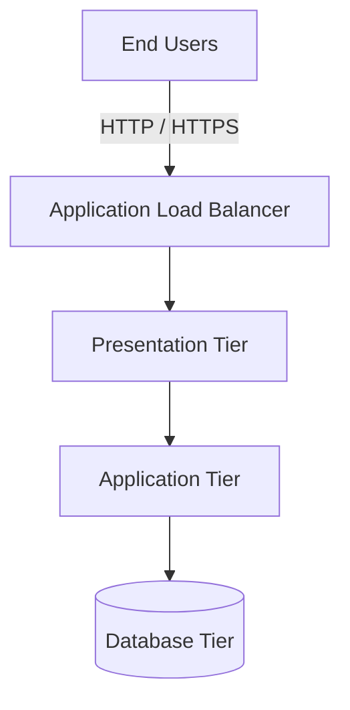

# Architecture — HA 3-Tier AWS Platform

## 1. Overview

The HA 3-Tier AWS Platform is designed around three logical layers:

1. **Presentation tier** — receives and handles incoming application traffic.
2. **Application tier** — processes application logic and business requests.
3. **Database tier** — stores and manages application data.

Separating these responsibilities helps improve maintainability, security, and scalability.

## 2. High-Level Architecture

This is a logical architecture diagram. Confirm the actual AWS resources and traffic paths in the Terraform configuration before treating it as the deployed architecture.

## 3. Tier Responsibilities

### Presentation Tier

Responsibilities:
- Receive application requests.
- Serve the presentation layer.
- Forward requests to the application tier.
- Support controlled access through the intended network entry point.

### Application Tier

Responsibilities:
- Process business logic.
- Communicate with the database tier.
- Scale according to workload requirements.
- Avoid exposing internal application services directly to the public internet.

### Database Tier

Responsibilities:
- Persist application data.
- Restrict access to authorized application components.
- Use backups and recovery mechanisms where configured.
- Protect data through appropriate encryption and access controls.

## 4. High Availability

A highly available design should consider:

- Deploying supported resources across multiple Availability Zones.
- Eliminating unnecessary single points of failure.
- Configuring health checks and traffic distribution.
- Planning database backup and recovery.
- Testing application behavior during resource failures.

Actual availability depends on the resources, redundancy, and recovery mechanisms implemented.

## 5. Network Security

Recommended network controls include:

- Public subnets only for components that require public reachability.
- Private subnets for internal application and database resources.
- Security-group rules restricted to necessary sources and ports.
- Least-privilege IAM permissions.
- No direct public access to the database.
- Encryption for data in transit and at rest where supported.

These are design recommendations; verify each control in the Terraform configuration.

## 6. Request Flow

1. A user sends a request to the application endpoint.
2. The configured entry point receives the request.
3. Traffic is forwarded to a healthy presentation or application target according to the implemented design.
4. The application processes the request.
5. If necessary, the application communicates with the database.
6. The response returns to the user.

The exact request path depends on the application's implementation and load-balancer configuration.

## 7. Infrastructure as Code

Terraform is used to define and manage infrastructure.

Typical workflow:

1. Review configuration and variables.
2. Run `terraform fmt`.
3. Initialize Terraform providers and modules.
4. Run `terraform validate`.
5. Review `terraform plan`.
6. Apply approved changes.
7. Verify the deployed resources.
8. Destroy test resources when they are no longer required.

## 8. Future Enhancements

Potential improvements include:

- Automated Terraform validation using GitHub Actions.
- HTTPS with managed certificates.
- Centralized logging and monitoring.
- Automated backups and recovery testing.
- Infrastructure security checks.
- Cost monitoring and resource optimization.

## 9. Design Limitations

A diagram alone does not establish that an architecture is highly available. Availability must be verified through actual resource placement, health checks, failure handling, and recovery testing.

## 10. Reliability and Failure Scenarios

A highly available platform should be evaluated against common failure scenarios.

| Scenario | Design consideration |
|---|---|
| Application instance failure | Health checks and replacement of unhealthy instances |
| Availability Zone failure | Redundant resources across supported Availability Zones |
| Database connectivity failure | Connection handling, timeouts, and recovery procedures |
| Traffic spike | Capacity planning and scaling configuration |
| Accidental infrastructure change | Terraform plan review and version-controlled changes |
| Data loss | Backups and tested recovery procedures |

### Verification Checklist

- [ ] Confirm the intended subnet placement of each tier.
- [ ] Verify that database access is restricted to approved sources.
- [ ] Review load-balancer target health.
- [ ] Confirm that redundant resources span the intended Availability Zones.
- [ ] Review database backup and recovery configuration.
- [ ] Test failure scenarios in a non-production environment.
- [ ] Record findings and corrective actions.

These items are verification tasks, not claims that the controls are already implemented. Mark each item complete only after testing the actual infrastructure.
