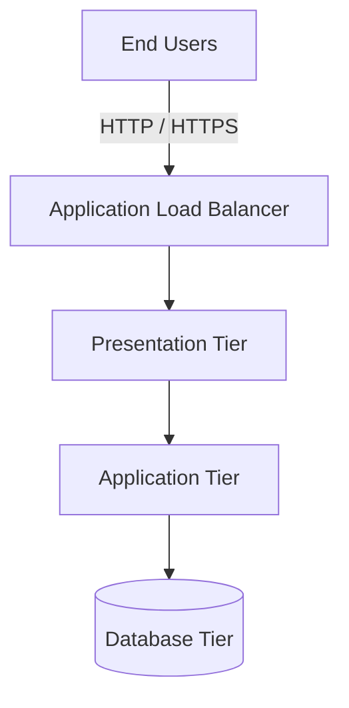

# Architecture — HA 3-Tier AWS Platform

## 1. Overview

The HA 3-Tier AWS Platform is designed around three logical layers:

1. **Presentation tier** — receives and handles incoming application traffic.
2. **Application tier** — processes application logic and business requests.
3. **Database tier** — stores and manages application data.

Separating these responsibilities helps improve maintainability, security, and scalability.

## 2. High-Level Architecture

This is a logical architecture diagram. Confirm the actual AWS resources and traffic paths in the Terraform configuration before treating it as the deployed architecture.

## 3. Tier Responsibilities

### Presentation Tier

Responsibilities:
- Receive application requests.
- Serve the presentation layer.
- Forward requests to the application tier.
- Support controlled access through the intended network entry point.

### Application Tier

Responsibilities:
- Process business logic.
- Communicate with the database tier.
- Scale according to workload requirements.
- Avoid exposing internal application services directly to the public internet.

### Database Tier

Responsibilities:
- Persist application data.
- Restrict access to authorized application components.
- Use backups and recovery mechanisms where configured.
- Protect data through appropriate encryption and access controls.

## 4. High Availability

A highly available design should consider:

- Deploying supported resources across multiple Availability Zones.
- Eliminating unnecessary single points of failure.
- Configuring health checks and traffic distribution.
- Planning database backup and recovery.
- Testing application behavior during resource failures.

Actual availability depends on the resources, redundancy, and recovery mechanisms implemented.

## 5. Network Security

Network segmentation should limit which components can communicate with each other.

| Component | Security review |
|---|---|
| Public entry point | Expose only required listener ports |
| Presentation tier | Allow only intended application traffic |
| Application tier | Restrict inbound traffic to approved sources |
| Database tier | Permit database access only from authorized application components |
| Administration | Avoid unrestricted management access |
| AWS APIs | Use appropriate IAM permissions and private endpoints where needed |

### Verification

- Review subnet route tables and network ACLs.
- Check security-group ingress and egress rules.
- Confirm that the database does not have unintended public exposure.
- Validate IAM permissions against least-privilege requirements.

These are design requirements to verify, not claims that every control is currently deployed.

## 6. Request Flow

1. A user sends a request to the application endpoint.
2. The configured entry point receives the request.
3. Traffic is forwarded to a healthy presentation or application target according to the implemented design.
4. The application processes the request.
5. If necessary, the application communicates with the database.
6. The response returns to the user.

The exact request path depends on the application's implementation and load-balancer configuration.

## 7. Infrastructure as Code

Terraform is used to define and manage infrastructure.

Typical workflow:

1. Review configuration and variables.
2. Run `terraform fmt`.
3. Initialize Terraform providers and modules.
4. Run `terraform validate`.
5. Review `terraform plan`.
6. Apply approved changes.
7. Verify the deployed resources.
8. Destroy test resources when they are no longer required.

## 8. Future Enhancements

Potential improvements include:

- Automated Terraform validation using GitHub Actions.
- HTTPS with managed certificates.
- Centralized logging and monitoring.
- Automated backups and recovery testing.
- Infrastructure security checks.
- Cost monitoring and resource optimization.

## 9. Design Limitations

A diagram alone does not establish that an architecture is highly available. Availability must be verified through actual resource placement, health checks, failure handling, and recovery testing.

## 10. Reliability Validation

Evaluate the infrastructure against realistic failure scenarios before describing it as highly available.

| Scenario | What to verify |
|---|---|
| Compute instance failure | Health checks and recovery behavior |
| Availability Zone outage | Resource distribution and remaining capacity |
| Database connectivity failure | Timeouts, connection recovery, and application behavior |
| Unexpected traffic spike | Capacity limits and scaling configuration |
| Accidental infrastructure change | Plan review and recovery procedure |
| Data loss | Backup availability and restoration testing |

Record the test, expected outcome, actual result, and corrective action.

Do not mark a scenario as passed until it has been tested. Actual resilience depends on the deployed resources and configuration.

## 11. Change Management

Infrastructure changes should be traceable and reviewable.

1. Identify the resources affected by a proposed change.
2. Update the relevant Terraform configuration.
3. Run formatting and validation.
4. Review the plan for unintended replacements or deletions.
5. Apply the change only after approval.
6. Verify the resulting infrastructure.
7. Record the outcome and any follow-up work.

Keep secrets and local Terraform state out of version control. Back up important data before destructive operations.
